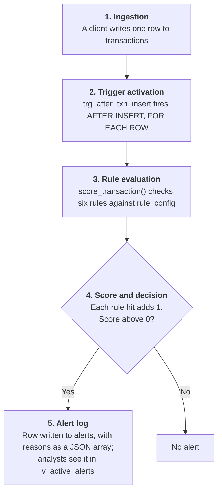

<div align="center">

# Sentinel

**In-database, real-time fraud detection, built one lab at a time**

[Live demo](https://haresh.acadnet.net/dbms/project/demo.html) · [How it works](#how-it-works) · [Weekly labs](#how-this-repository-is-organised) · [Run it](#run-it)


</div>

A banking-style MySQL database where **fraud detection lives inside the database**. Insert a transaction; a trigger scores it against six rules, each compared with that account's own history, and writes an alert that says *why*. No writer can skip the check, because the check is part of the `INSERT`.

## Team

| Name | GitHub |
|---|---|
| Sai Haresh Anand S | [@SAI-HARISH2007](https://github.com/SAI-HARISH2007) |
| Dulam Seshivardhini | [@seshivardhini2006](https://github.com/seshivardhini2006) |

**Course:** CS/AI/AIM/DS 202 Database Management Systems, Semester III, A.Y. 2026-27, ICFAI Faculty of Science & Technology

## How it works

Five stages, all inside one `INSERT`. Nothing leaves the database server. The [interactive demo](https://haresh.acadnet.net/dbms/project/demo.html) lets you step through them with your own transaction.



* **Atomic.** The trigger runs inside the `INSERT`'s own transaction: no scored transaction without its alert, and a scoring error rolls back the insert.
* **Tunable.** Thresholds are rows in `rule_config`, read on every call, so changing one is an `UPDATE` and not a redeploy.
* **Explainable.** Each rule that fires appends its own text to the alert's JSON `reasons` array.

### The six rules

| # | Rule | Fires when (default threshold) |
|---|---|---|
| 1 | High amount | The amount's z-score against the account's history is above 3 |
| 2 | Off-hours | Under 2% of the account's transactions fall in this hour |
| 3 | New device | The device has never been seen on this account |
| 4 | Velocity | More than 5 transactions in 5 minutes |
| 5 | Impossible travel | Implied speed from the previous transaction is above 900 km/h |
| 6 | Merchant risk | The merchant's alert rate is over 2× the platform average |

The [demo page](https://haresh.acadnet.net/dbms/project/demo.html) re-implements this logic in JavaScript for illustration and does not connect to the database. The real engine is [`score_transaction`](week-10-procedures-triggers/sql/20_score_transaction.sql) and its [triggers](week-10-procedures-triggers/sql/30_triggers.sql).

## How this repository is organised

The project is built **one lab at a time**. Each `week-NN-*` folder is one lab experiment and adds one layer; folders only depend on earlier ones.

| Week | Lab experiment | Adds |
|---|---|---|
| [1](week-01-intro-er-design/) | Intro to MySQL, ER design | Problem statement, ER diagram, ER→tables rules, `CREATE DATABASE` |
| [2](week-02-ddl/) | DDL | 13 tables (columns only); ALTER / RENAME / DROP COLUMN |
| [3](week-03-constraints/) | Constraints | PK, FK, UNIQUE, NOT NULL, DEFAULT, CHECK; 3NF argument |
| [4](week-04-dml/) | DML | Rule thresholds + 12,067 transactions + 5 fraud personas |
| [5](week-05-functions/) | Functions | Rule 1 (z-score), Rule 2 preview, Rule 5 by hand |
| [6](week-06-operators/) | Operators | All operator families, first-cut fraud screen |
| [7](week-07-joins/) | Joins | Rule 3 (new device), Rule 4 pairs, Rule 5 for all accounts |
| [8](week-08-groupby-subqueries/) | GROUP BY / HAVING / ORDER BY, subqueries | Rules 1, 2, 4 for all accounts; baselines |
| [9](week-09-views-indexes-dcl/) | Views, indexes (+ DCL) | Six rule views, combined risk view, measured indexes, roles |
| [10](week-10-procedures-triggers/) | Procedures and triggers | `score_transaction`, triggers, event, `transfer_funds` |
| [11](week-11-final-polish/) | Final | 27 pytest tests, report/slides/demo/viva material, limitations |

## Run it

**Web app:** `app/` holds the Flask backend (`app/app.py`) and frontend (`app/static/index.html`). Run it with `bash app/run.sh`; see [`LAB_SETUP.md`](LAB_SETUP.md).

**Database:** needs Docker (MySQL 8.4 image) — or your own MySQL 8.0.31+ (set `DB_HOST=127.0.0.1`).

```bash
make up                 # start MySQL
make week N=5           # database exactly as it was at the end of week 5, then run that week's checks
make all                # the finished project (weeks 1-10) + 102 automated assertions
make shell              # a mysql prompt on the finished database
make test               # pytest (27 tests)
```

`scripts/build.sh N` loads weeks 1..N; `scripts/check.sh N` verifies them. The 90-second demo is `week-10-procedures-triggers/demo/01_fraud_demo.sql`.

## Also in here
* [`AGENTS.md`](AGENTS.md) — briefing for any AI assistant or new teammate picking the project up.
* [`docs/LAB_EXAM_CHEATSHEET.md`](docs/LAB_EXAM_CHEATSHEET.md) — MySQL syntax for lab experiments 1-9.
* [`week-11-final-polish/docs/`](week-11-final-polish/docs/) — viva Q&A, limitations, performance numbers, demo script.

The first, single-commit version of the project: https://github.com/SAI-HARISH2007/sentinel-sql

Licence: [MIT](LICENSE).
