# Sentinel: In-Database Real-Time Fraud & Anomaly Engine

**Course:** CS/AI/AIM/DS 202 Database Management Systems (Semester III, A.Y. 2026-27)
**Institution:** ICFAI Foundation for Higher Education (IcfaiTech), Hyderabad
**Authors:** Sai Haresh Anand S (25STUCHH010419) and Dulam Seshivardhini (25STUCHH001048)
**Source code:** https://github.com/SAI-HARISH2007/sentinel-sql-progress
**Platform:** MySQL 8.4 (developed in Docker), plain SQL, no application code in the detection path

---

## 1. Abstract

Most fraud checks live in the application that accepts the payment. The trouble is that anything which writes to the database without going through that application (a batch job, an admin script, a second service) creates transactions that nobody scored. Sentinel puts the check inside the database instead. Every `INSERT` into `transactions` fires an `AFTER INSERT` trigger, which calls the stored procedure `score_transaction()`. The procedure applies six rules: amount Z-score, impossible travel (Haversine distance), frequency velocity, unseen device, off-hours activity and merchant risk. The thresholds come from the `rule_config` table. If any rule fires, a row goes into `alerts` with a JSON array listing the reasons.

The database has 13 tables in third normal form, 11 views, one user-defined function, four procedures, three triggers, a nightly event and four roles. It is seeded with 12,067 transactions across 500 users and 597 accounts. Fund transfers go through `transfer_funds()`, which takes row locks in a fixed order so two opposite transfers cannot deadlock. On a laptop, the trigger takes an insert from about 0.04 ms to about 2 ms, roughly 500 scored transactions per second. A date-range report dropped from a full scan (cost 1,349) to an index range scan (cost 174) once `txn_time` was indexed. 102 SQL assertions and 27 Python integration tests check all of it.

## 2. Problem Statement and Objectives

### 2.1 Why application-tier fraud checks fall short

An application-side check has five problems.

1. It only runs where a developer remembered to call it. Direct SQL, data imports and a second service all skip it.
2. If the application commits first and scores afterwards, there is a gap in which an unscored transaction is visible and can be spent.
3. Scoring needs history: the account's mean and deviation, its previous location, the last five minutes of activity. Fetching that over the network for every payment costs latency, when the database already has it sitting next to an index.
4. Thresholds are hard-coded, so changing one means a redeploy.
5. The reason an alert fired usually ends up in a log line instead of a table you can query.

### 2.2 Objectives

| # | Objective | How Sentinel meets it |
|---|---|---|
| O1 | Score every transaction regardless of who inserted it | `AFTER INSERT` trigger on `transactions` |
| O2 | Explain every alert | `alerts.reasons` JSON array, one entry per rule fired |
| O3 | Make policy data, not code | `rule_config` holds every threshold and an enabled flag |
| O4 | Keep money movement all-or-nothing | `transfer_funds()` with `START TRANSACTION`, `FOR UPDATE`, `COMMIT`/`ROLLBACK` |
| O5 | Least-privilege access | Four roles; the reporting role cannot read raw transactions |
| O6 | Measure the cost honestly | `EXPLAIN ANALYZE` plans and timed inserts, with limitations documented |

## 3. Requirements and Entity-Relationship Design

### 3.1 Functional requirements

- Store users, their accounts, the devices and locations they transact from, and the merchants they pay.
- Record each transaction with amount, time, merchant, device, location and status.
- On each new transaction, decide whether it is suspicious and record why.
- Let an analyst move an alert through `open → investigated → confirmed | false_positive`, with the review time stamped and the change audited.
- Provide reporting views for dashboards without exposing base tables.
- Move funds between accounts atomically.

### 3.2 Entity sets

| Table | Role | Primary key |
|---|---|---|
| `merchant_categories` | Lookup: category names | `category_id` |
| `locations` | Lookup: city, state, country, latitude, longitude | `location_id` |
| `devices` | Device type, OS, browser, fingerprint hash | `device_id` |
| `rule_config` | One row per fraud rule: enabled flag, threshold, parameters JSON | `rule_id` |
| `users` | Customer identity (name, unique email, phone) | `user_id` |
| `accounts` | Savings or current account owned by a user, with balance and status | `account_id` |
| `merchants` | Merchant with category, home coordinates, risk score | `merchant_id` |
| `account_devices` | Associative table for the many-to-many link between accounts and devices | (`account_id`, `device_id`) |
| `transactions` | The fact table; 12,067 rows | `txn_id` |
| `alerts` | Output of the scoring engine | `alert_id` |
| `behaviour_baselines` | Per-account average, deviation, usual hours and cities | `baseline_id` |
| `login_history` | Account logins by device and location | `login_id` |
| `audit_log` | Who changed which row, with old and new values as JSON | `audit_id` |

### 3.3 Relationships and foreign-key mapping

```
merchant_categories 1 ──< merchants 1 ──< transactions >── 1 accounts >── 1 users
                                                 │  ╲                │
                                                 │   ╲ N:1 devices ──┤ M:N via account_devices
                                                 │    ╲ N:1 locations
                                                 1
                                                 │
                                          alerts (1:1, UNIQUE txn_id)

accounts 1 ── 1 behaviour_baselines       accounts 1 ──< login_history >── devices, locations
```

| Foreign key | References | On delete | Reasoning |
|---|---|---|---|
| `accounts.user_id` | `users` | CASCADE | An account has no meaning without its owner |
| `merchants.category_id` | `merchant_categories` | RESTRICT | A category in use cannot disappear |
| `account_devices.account_id` / `device_id` | `accounts` / `devices` | CASCADE | A link row dies with either side |
| `transactions.account_id` | `accounts` | CASCADE | History belongs to the account |
| `transactions.merchant_id` / `device_id` / `location_id` | `merchants` / `devices` / `locations` | RESTRICT | Referenced reference data must not vanish silently |
| `alerts.txn_id` | `transactions` | CASCADE | An alert explains one transaction |
| `behaviour_baselines.account_id` | `accounts` | CASCADE | Derived data follows its account |
| `login_history.account_id` | `accounts` | CASCADE | |
| `login_history.device_id` / `location_id` | `devices` / `locations` | RESTRICT | |

Other declared constraints: `UNIQUE` on `users.email`, `devices.fingerprint_hash`, `rule_config.rule_name`, `merchant_categories.category_name`, `(locations.city, locations.country)`, `alerts.txn_id` and `behaviour_baselines.account_id`; `CHECK (amount > 0)` on transactions; `CHECK (balance >= 0)` on accounts; range checks on latitude and longitude.

The schema was built week by week for the lab: Week 2 creates bare tables and Week 3 adds keys and constraints with `ALTER TABLE`. The end result is the same as declaring everything inline, and a fingerprint script compares it against a reference. The alerts table starts as `fraud_alerts` in Week 2 and is renamed to `alerts` later (its unused `notes` column is dropped at the same time), so older week notes may still use the first name.

## 4. Normalised Relational Schema (1NF, 2NF, 3NF)

For each table we wrote down the functional dependencies (FDs) that follow from the business rules, found the candidate keys, and checked three conditions.

- **1NF:** every column is atomic and single-valued, and every row is identified by a key.
- **2NF:** no non-key attribute depends on a proper part of a composite key.
- **3NF:** for every non-trivial FD X → A, either X is a superkey or A is part of a candidate key. Equivalently, no non-key attribute depends on another non-key attribute.

### 4.1 Table-by-table verification

| Table | Candidate keys | Non-trivial functional dependencies | Result |
|---|---|---|---|
| `users` | `user_id`, `email` | `user_id → full_name, email, phone, created_at`; `email → user_id` | Every determinant is a candidate key → 3NF (BCNF) |
| `accounts` | `account_id` | `account_id → user_id, account_type, balance, status, created_at` | Single-column key rules out partial dependency (2NF). No non-key column determines another → 3NF |
| `merchants` | `merchant_id` | `merchant_id → merchant_name, category_id, city, latitude, longitude, risk_score` | The category name is not stored here; it is reached through `category_id`, so `category_id → category_name` stays in `merchant_categories` → 3NF |
| `transactions` | `txn_id` | `txn_id → account_id, merchant_id, device_id, location_id, amount, txn_time, status, metadata_json` | City, device type and merchant name are not repeated here; they live in the tables the foreign keys point to → 3NF |
| `rule_config` | `rule_id`, `rule_name` | `rule_id → rule_name, enabled, threshold_value, parameters_json, updated_at`; `rule_name → rule_id` | Both determinants are candidate keys → 3NF (BCNF) |
| `alerts` | `alert_id`, `txn_id` | `alert_id → txn_id, rule_name, risk_score, reasons, status, created_at, reviewed_at`; `txn_id → alert_id` | Both determinants are candidate keys → 3NF (BCNF) |
| `account_devices` | (`account_id`, `device_id`) | (`account_id`, `device_id`) → `first_seen`, `last_seen` | The only composite-key table. Both columns describe the pairing, not either side alone, so there is no partial dependency → 2NF and 3NF |

The remaining six tables (`merchant_categories`, `locations`, `devices`, `behaviour_baselines`, `login_history`, `audit_log`) each have a single-column surrogate key and no dependency between non-key columns. In `locations`, `city → country` is not declared as a dependency because the same city name can occur in more than one country; the candidate key is (`city`, `country`) and `latitude`, `longitude` depend on it.

### 4.2 1NF in the presence of JSON columns

`alerts.reasons`, `rule_config.parameters_json`, `transactions.metadata_json` and the two JSON columns in `behaviour_baselines` hold structured documents. We treat them as atomic values, because the engine never joins on or filters by anything inside them. `reasons` is output that an analyst reads whole, and `parameters_json` holds free-form rule parameters. If we ever needed "all alerts that cite rule X", that would be the point to split out a child table.

### 4.3 One deliberate redundancy

`behaviour_baselines` stores values that could be computed from `transactions` (mean, standard deviation, active hours, typical cities). We kept it as a cache. The nightly procedure rebuilds it in full, so it is never more than a day stale, and reports do not have to aggregate an account's whole history each time.

## 5. Advanced Database Features

### 5.1 The six fraud rules

Each rule that fires adds one point to the score and appends a readable string to the `reasons` array. One fired rule is enough to raise an alert. There is no combined threshold; each rule has its own, read from `rule_config` when the transaction is scored.

| # | Rule | Condition | Default threshold |
|---|---|---|---|
| 1 | Amount Z-score | `(amount − AVG) / STDDEV_SAMP` over the account's history exceeds the threshold; requires at least 5 prior-or-current rows and a non-zero deviation | 3 |
| 2 | Travel velocity | Haversine distance to the previous transaction is above 50 km and implied speed exceeds the limit | 900 km/h |
| 3 | Frequency velocity | Number of transactions by the account inside the window, including the new one, exceeds the limit | more than 5 in 5 minutes |
| 4 | New device | The device is not in `account_devices` for this account | 1 (enabled) |
| 5 | Off-hours | The hour of day accounts for less than 2% of the account's history | 0.02 |
| 6 | Merchant risk | The merchant has at least 3 transactions and at least 3 alerts, and its alert rate divided by the platform-wide alert rate exceeds the threshold | 2 (min. alerts 3) |

Haversine is implemented as the deterministic function `haversine_km(lat1, lon1, lat2, lon2)` with Earth radius R = 6371 km:

```
a = sin²(Δφ/2) + cos φ1 · cos φ2 · sin²(Δλ/2)
d = 2R · asin(√a)
```

Hyderabad (17.385, 78.4867) to Tokyo (35.6762, 139.6503) comes out at 6,311.39 km in MySQL. If the two payments are 15 minutes apart, the implied speed is 25,246 km/h against a 900 km/h limit. The 50 km floor is there because two nearby places with close timestamps would otherwise give a huge speed from a tiny distance divided by a tiny time.

The Z-score rule has a ceiling. The trigger fires after the insert, so the new row is already part of the average and standard deviation it is compared with. With n values, one outlier can never score above (n − 1)/√n, which is about 7.9 for 65 transactions. That makes the rule a little conservative on short histories. We left it and listed it as a limitation, because using only earlier rows would cost a second query on every insert.

### 5.2 Scoring pipeline: `trg_after_txn_insert` and `score_transaction()`

```sql
CREATE TRIGGER trg_after_txn_insert
AFTER INSERT ON transactions
FOR EACH ROW
BEGIN
    CALL score_transaction(NEW.txn_id);
END;
```

The trigger is `AFTER` because the procedure reads the stored row, and a `BEFORE` trigger runs before that row exists. It is a row-level trigger, so a multi-row `INSERT` scores each row.

`score_transaction(p_txn_id)` loads the transaction and the `rule_config` rows, evaluates each enabled rule, builds the `reasons` array with `JSON_ARRAY`, and, if the score is above zero, writes

```sql
INSERT INTO alerts (txn_id, rule_name, risk_score, reasons, status)
VALUES (..., 'combined', v_score, v_reasons, 'open')
ON DUPLICATE KEY UPDATE ...;
```

Because `txn_id` is `UNIQUE`, scoring the same transaction twice updates the alert instead of duplicating it. If the score comes out as zero, any open alert for that transaction is deleted, so re-running after a threshold change keeps the table correct. `backfill_alerts(first, last)` applies the same logic to a range of old transactions.

Two more triggers cover the analyst workflow. `trg_before_alert_update` stamps `reviewed_at` when an alert leaves `open`. `trg_after_alert_update` writes the old and new status to `audit_log`. It uses `USER()` and not `CURRENT_USER()`, because inside a trigger `CURRENT_USER()` returns the definer, and every audit row would then say root.

### 5.3 Baseline maintenance: `refresh_behaviour_baselines()`

```sql
CREATE PROCEDURE refresh_behaviour_baselines()
BEGIN
    DECLARE EXIT HANDLER FOR SQLEXCEPTION BEGIN ROLLBACK; RESIGNAL; END;
    START TRANSACTION;
    DELETE FROM behaviour_baselines;
    INSERT INTO behaviour_baselines (account_id, avg_amount, stddev_amount,
                                     peak_hours_json, typical_cities_json)
    SELECT ... AVG(amount), STDDEV_SAMP(amount), JSON_ARRAYAGG(hour), JSON_ARRAYAGG(city)
    FROM transactions ... GROUP BY account_id;
    COMMIT;
END;
```

The delete and rebuild share one transaction with an exit handler, so if anything fails the old baselines stay and the table is not left empty. The event `evt_refresh_baselines` calls it daily at 02:30, which needs the event scheduler to be on.

### 5.4 ACID transfers: `transfer_funds()`

`transfer_funds()` moves money between two accounts and records the debit as a transaction, so the scoring trigger evaluates it like any other payment.

```sql
DECLARE EXIT HANDLER FOR SQLEXCEPTION BEGIN ROLLBACK; RESIGNAL; END;

IF p_amount IS NULL OR p_amount <= 0 THEN SIGNAL SQLSTATE '45000' ...;
IF p_from_account = p_to_account      THEN SIGNAL SQLSTATE '45000' ...;

START TRANSACTION;

IF p_from_account < p_to_account THEN
    SELECT balance, status INTO v_from_balance, v_from_status
      FROM accounts WHERE account_id = p_from_account FOR UPDATE;
    SELECT status INTO v_to_status
      FROM accounts WHERE account_id = p_to_account   FOR UPDATE;
ELSE
    SELECT status INTO v_to_status
      FROM accounts WHERE account_id = p_to_account   FOR UPDATE;
    SELECT balance, status INTO v_from_balance, v_from_status
      FROM accounts WHERE account_id = p_from_account FOR UPDATE;
END IF;

-- missing / inactive account or insufficient funds: ROLLBACK, then SIGNAL

UPDATE accounts SET balance = balance - p_amount WHERE account_id = p_from_account;
UPDATE accounts SET balance = balance + p_amount WHERE account_id = p_to_account;
INSERT INTO transactions (account_id, merchant_id, device_id, location_id, amount, status)
VALUES (p_from_account, 1, p_device_id, p_location_id, p_amount, 'success');

COMMIT;
```

| Property | Mechanism |
|---|---|
| Atomicity | Debit, credit and the transaction record commit together; the exit handler rolls back on any error, including one raised inside the scoring trigger |
| Consistency | Validation in the procedure, plus `CHECK (balance >= 0)` as a backstop |
| Isolation | `SELECT … FOR UPDATE` takes exclusive row locks, so a concurrent transfer on the same account waits instead of reading a stale balance |
| Durability | InnoDB redo log flushed at `COMMIT` |

Deadlock is the main risk. If a transfer A→B and a transfer B→A each locked their own source account first, each would then wait on the other forever. The procedure therefore always locks the lower `account_id` first. Every transfer takes locks in the same order, so a cycle of waits cannot form.

Only the sender's debit is recorded as a transaction, against placeholder merchant 1. Money received is not a purchase, and recording it would distort the receiver's spending statistics.

### 5.5 Indexing and performance

The indexes were added in Week 9, after the schema and the rule queries existed, so each one serves a query we had already written:

| Index | Serves |
|---|---|
| `idx_txn_account_time (account_id, txn_time)` | Per-account velocity, previous-transaction lookup, baselines, latest-N queries |
| `idx_txn_merchant_time (merchant_id, txn_time)` | Merchant risk and merchant timelines |
| `idx_txn_time (txn_time)` | Date-range reports |
| `idx_txn_location (location_id)` | Location joins |
| `idx_alert_status (status, created_at)` | The open-alerts view |
| `idx_alert_rule (rule_name)` | Alerts by rule |

Measured with `EXPLAIN ANALYZE` on MySQL 8.4.11:

| Query | Before | After | Plan change |
|---|---|---|---|
| Daily report over a 6-day range (reads of 12,067 rows → 315) | cost 1,349, table scan | cost 174, range scan on `idx_txn_time` | about 8× cheaper |
| Latest 50 transactions of one account | cost 18.2 with filesort | cost 18.2, no sort | Same cost; the composite index removes the `Sort` step because rows come out already ordered |
| Merchant 50, newest 20 | cost 88.5 | reverse scan on `idx_txn_merchant_time` | no sort |

So the drop from 1,349 to 174 comes from the single-column index on `txn_time` serving a range predicate. The composite index on `(account_id, txn_time)` does something different. An account has only about 52 rows on average, so the optimiser's cost barely moves, but the velocity and travel rules get an account's recent rows already in time order, with no sort. We report both numbers as measured and do not give the composite index credit for the bigger one.

### 5.6 Backend, frontend and source code

Sentinel has no separate application server. The backend is the MySQL database itself: the trigger, the stored procedures, the views and the `rule_config` table do all the detection, and a client only has to run `INSERT` and `SELECT`. Two roles define how a client may talk to it. `txn_app` may `INSERT` into `transactions` and call `transfer_funds()`. `api_reader` may only `SELECT` from four views and `rule_config`, so a reporting layer can read alerts but cannot change anything.

There is no web application connected to the live database yet. A FastAPI service that reads through `api_reader` and a dashboard on top of it are planned (Section 8). What exists today is `demo.html`, a single page that runs in any browser and re-implements the six rules in JavaScript. It has three parts: a simulator where the viewer picks a persona or moves sliders for amount, time of day, device and location; an animated five-stage pipeline (INSERT, trigger, rule evaluation, score, alert row); and an architecture diagram of the tables, trigger and procedures. Appendix C shows the screenshots. It does not talk to MySQL, so the SQL scripts remain the authoritative behaviour.

The 27 Python tests (`pytest`) connect to the running database and check the same behaviour from outside, through the database driver.

Source code, all week-wise scripts, the demo page and this report are in the public repository: https://github.com/SAI-HARISH2007/sentinel-sql-progress

## 6. Experimental Benchmarks and Evaluation

All measurements used MySQL 8.4.11 in Docker on a laptop under WSL2, one connection, with the 12,067-transaction data set (500 users, 597 accounts, 50 merchants).

### 6.1 Trigger overhead

1,000 inserts were timed inside a transaction that was then rolled back, once with the trigger dropped and once with it present.

| Configuration | Time for 1,000 inserts | Per row |
|---|---|---|
| No trigger | about 41 ms | about 0.04 ms |
| With `trg_after_txn_insert` | about 1,980 ms | about 2 ms |

Scoring makes each insert about 50 times slower, which is about 2 ms in absolute terms, or roughly 500 scored transactions per second on one connection. If a person is waiting on a card or UPI confirmation, 2 ms does not matter. For bulk loading it does.

### 6.2 Bulk loading

When we loaded the seed data with the trigger already installed, it stalled at 5,925 rows after 250 seconds, since every row ran the full scoring procedure against a growing table. So the repository loads the data first and creates the trigger last (about 20 s for weeks 1–9), then scores the history in one pass with `backfill_alerts(1, 12067)`. That takes about 38 s and produces 634 alerts, about 5% of transactions.

### 6.3 Detection check

We planted 27 persona transactions (ids 12041–12067) to exercise each rule. They produce 21 alerts, and an ordinary purchase produces none. The 102 SQL assertions across 11 weeks and the 27 Python tests all pass as of this writing.

### 6.4 Known limitations

- The seed data assigns random cities to transactions, so the travel rule fires 32–46 times on data that is synthetic rather than fraudulent.
- On amounts with a skewed distribution, a Z-score above 3 flags about 1.2% of rows (145 of 12,067). Amount is a poor fit for a normal-distribution test; a log transform would help.
- The off-hours rule is unreliable below about 50 transactions per account.
- Merchant risk feeds on alerts that other rules produce, so it can reinforce itself. The `min_alerts = 3` guard limits this but does not remove it.
- The baseline includes the row being scored (see 5.1).
- There is no user interface of its own (`demo.html` is only an explainer), and the code uses MySQL-specific syntax.

## 7. Viva Questions and Discussion

**Q1. What does the scoring trigger cost, and is that acceptable?**
About 2 ms per inserted row in our test, against 0.04 ms without it, so one connection scores around 500 transactions per second. For an interactive payment that is well under anything a user would notice, and the work is a handful of indexed lookups. Bulk loading is where it hurts: our seed load stalled with the trigger in place, so we load first, create the trigger afterwards and use `backfill_alerts()` for history. Beyond a few thousand scored inserts per second we would move scoring to an asynchronous queue, and give up the guarantee that scoring finishes before the insert returns.

**Q2. Why `AFTER INSERT` and not `BEFORE`?**
`score_transaction()` looks the transaction up by id and aggregates over the account's rows including this one, so the row must already exist. A `BEFORE` trigger can change `NEW` or reject the row, but it runs before the row is stored. We use `BEFORE UPDATE` only where changing `NEW` is the whole point, to stamp `reviewed_at`. The price of `AFTER` is that the new row is part of the average and deviation, which caps the Z-score near (n − 1)/√n.

**Q3. Explain the locking in `transfer_funds()`. How is deadlock avoided?**
`SELECT … FOR UPDATE` inside a transaction takes an exclusive InnoDB row lock on the account and holds it until `COMMIT` or `ROLLBACK`. A second transfer on the same account waits, and when it resumes it reads the committed balance, so two transfers cannot spend the same money. A deadlock needs two sessions that each hold one lock and want the other's. We always lock the lower account id first, so A→B and B→A both start with the same row and the second one just waits. Without that rule InnoDB would detect the cycle and abort one of them. With it, that situation never arises.

**Q4. What is the trade-off of putting fraud logic in the database?**
In its favour: no writer can bypass it, there is no gap between commit and check, history is read next to its indexes, and an administrator can change a threshold without a release. Against it: the scoring uses database CPU on the write path, the code is MySQL-specific and harder to test and debug than application code, a bug in a trigger can make the original insert fail, and the database is usually the hardest tier to scale, which now carries scoring as well. We handle this by keeping the rules simple, indexed and set-based, and by keeping any model-style analysis outside the database.

**Q5. The report shows cost falling from 1,349 to 174. What caused it, and what does the composite index do?**
The drop is a date-range report on `transactions` going from a full table scan of 12,067 rows to an index range scan of 315 rows, using the single-column index `idx_txn_time`. The composite index `(account_id, txn_time)` follows the leftmost-prefix rule: it helps filters on `account_id`, or `account_id` plus a time range, and returns an account's rows already sorted by time. For "latest 50 of an account" it did not lower the cost (18.2 either way, since an account has only about 52 rows), but it removed the sort step, which the scoring rules benefit from. It does nothing for a filter on `txn_time` alone, which is why we have both indexes.

## 8. Conclusion and Future Scope

Sentinel shows that a working fraud check can sit entirely inside a relational database. One trigger makes sure every transaction is scored, whoever inserted it. Thresholds are ordinary rows, every alert carries a JSON explanation, and transfers stay atomic under concurrent access because locks are always taken in the same order. Scoring costs about 2 ms per insert, and indexing brought a representative report from cost 1,349 down to 174. The evaluation also records the weak spots: the seeded cities are random, so the travel rule fires on synthetic data; a Z-score suits skewed amounts poorly; and the baseline includes the row being tested.

Future work, roughly in the order we would do it:

1. Compute the baseline from earlier transactions only, which removes the Z-score ceiling.
2. Give each account a home city, so the travel rule compares against habitual locations and not only the previous row.
3. Base merchant risk on confirmed fraud (`alerts.status = 'confirmed'`) instead of raw alerts, to break the feedback loop.
4. Replace the plain Z-score with a robust one (median and MAD, or a Z-score on log amounts).
5. Put a thin read-only API on the `api_reader` role, with a dashboard over the existing reporting views.
6. Add a `txn_type` column so transfers, purchases and refunds can be scored differently.
7. Try the asynchronous alternative (queue plus worker) and measure its latency and throughput against the in-trigger design.

---

*Figures in this report were measured on the project database; the supporting scripts and EXPLAIN output are in `week-09-views-indexes-dcl/docs/benchmark_measured.md` and `week-11-final-polish/docs/performance.md`.*

<!--APPENDIX-->

---

## Appendix A. Code Excerpts

Only the pieces discussed in the report are reproduced here, with the explanatory comments removed to save space. The complete, commented scripts are in the repository under `week-NN-*/sql/`.

### A.1 Indexes

`week-09-views-indexes-dcl/sql/30_indexes.sql`

```sql
USE sentinel;

CREATE INDEX idx_txn_account_time  ON transactions (account_id, txn_time);
CREATE INDEX idx_txn_merchant_time ON transactions (merchant_id, txn_time);
CREATE INDEX idx_txn_location      ON transactions (location_id);
CREATE INDEX idx_txn_time          ON transactions (txn_time);

CREATE INDEX idx_alert_status ON alerts (status, created_at);
CREATE INDEX idx_alert_rule   ON alerts (rule_name);

CREATE INDEX idx_lh_account_time   ON login_history (account_id, login_time);
CREATE INDEX idx_audit_table_time  ON audit_log (table_name, changed_at);

CREATE INDEX idx_ad_device ON account_devices (device_id);
```

### A.2 Triggers

`week-10-procedures-triggers/sql/30_triggers.sql`

```sql
USE sentinel;

DROP TRIGGER IF EXISTS trg_after_txn_insert;
DELIMITER //
CREATE TRIGGER trg_after_txn_insert
AFTER INSERT ON transactions
FOR EACH ROW
BEGIN
    CALL score_transaction(NEW.txn_id);
END //
DELIMITER ;

DROP TRIGGER IF EXISTS trg_before_alert_update;
DELIMITER //
CREATE TRIGGER trg_before_alert_update
BEFORE UPDATE ON alerts
FOR EACH ROW
BEGIN
    IF OLD.status = 'open' AND NEW.status <> 'open' AND NEW.reviewed_at IS NULL THEN
        SET NEW.reviewed_at = CURRENT_TIMESTAMP;
    END IF;
END //
DELIMITER ;

DROP TRIGGER IF EXISTS trg_after_alert_update;
DELIMITER //
CREATE TRIGGER trg_after_alert_update
AFTER UPDATE ON alerts
FOR EACH ROW
BEGIN
    IF OLD.status <> NEW.status THEN
        INSERT INTO audit_log (table_name, record_id, action, old_value_json, new_value_json, changed_by)
        VALUES ('alerts', NEW.alert_id, 'UPDATE',
                JSON_OBJECT('status', OLD.status),
                JSON_OBJECT('status', NEW.status),
                USER());
    END IF;
END //
DELIMITER ;
```

### A.3 The `api_reader` role

`week-09-views-indexes-dcl/sql/40_roles_dcl.sql`

```sql
CREATE ROLE IF NOT EXISTS 'api_reader';
GRANT SELECT ON sentinel.v_active_alerts      TO 'api_reader';
GRANT SELECT ON sentinel.v_daily_txn_summary  TO 'api_reader';
GRANT SELECT ON sentinel.v_top_risky_users    TO 'api_reader';
GRANT SELECT ON sentinel.v_alerts_by_city_day TO 'api_reader';
GRANT SELECT ON sentinel.rule_config          TO 'api_reader';
GRANT 'api_reader'    TO 'api_user'@'%';
```

The six rule views, `score_transaction`, `transfer_funds` and the constraint definitions are in `week-09-views-indexes-dcl/sql/10_rule_views.sql`, `week-10-procedures-triggers/sql/20_score_transaction.sql`, `50_transfer_funds.sql` and `week-03-constraints/sql/01_constraints.sql`.

## Appendix B. Captured Terminal Output

Each figure was produced by running the shown statement against the live `sentinel-db` container (MySQL 8.4) and capturing the unedited result on 21 Oct 2026. Figures B.11 and B.12 are the repository test runs.

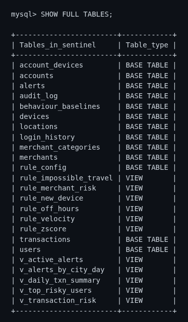

**Figure B.1 Thirteen base tables and eleven views.**


**Figure B.2 Structure of `transactions`.**


**Figure B.3 The eight `rule_config` rows.**


**Figure B.4 A `CHECK` constraint rejecting a negative amount.**


**Figure B.5 Least-privilege grants of `api_reader`.**

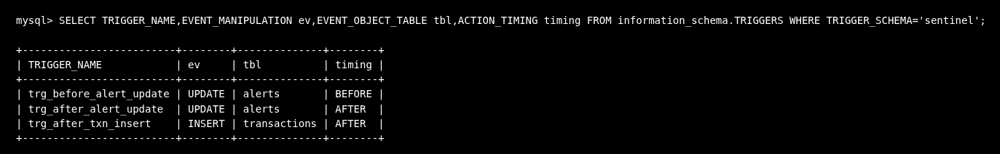

**Figure B.6 Triggers registered in the schema.**

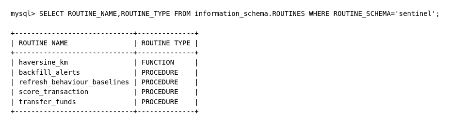

**Figure B.7 Stored routines.**

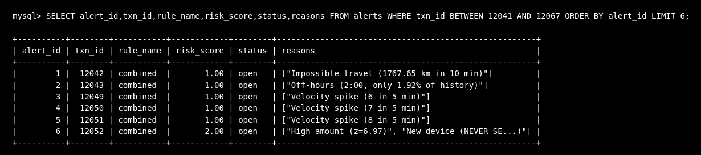

**Figure B.8 Alerts raised for the scripted persona transactions.**


**Figure B.9 `v_top_risky_users`.**


**Figure B.10 `EXPLAIN` of a date-range query using `idx_txn_time`.**

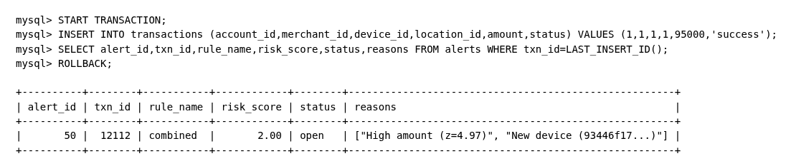

**Figure B.11 Live trigger demonstration (insert, alert appears, rollback).**

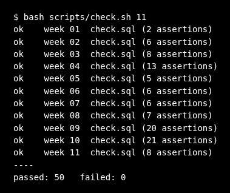

**Figure B.12 SQL assertion suite, per-week results (2+6+8+13+5+6+6+7+20+21+8 = 102 assertions in 50 check files).**

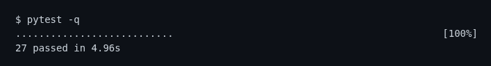

**Figure B.13 Python test suite.**


## Appendix C. Interactive Demonstration

`demo.html` is a standalone page that re-implements the six rules in JavaScript so the pipeline can be explained without a database connection. It is an explanatory aid; the authoritative behaviour is the SQL above. Screenshots below were captured from the page and converted to black on white for printing. Figure C.1 shows the landing view. Figures C.2 to C.4 show the engine pipeline (the five stages from INSERT to alert row) for three of the personas.

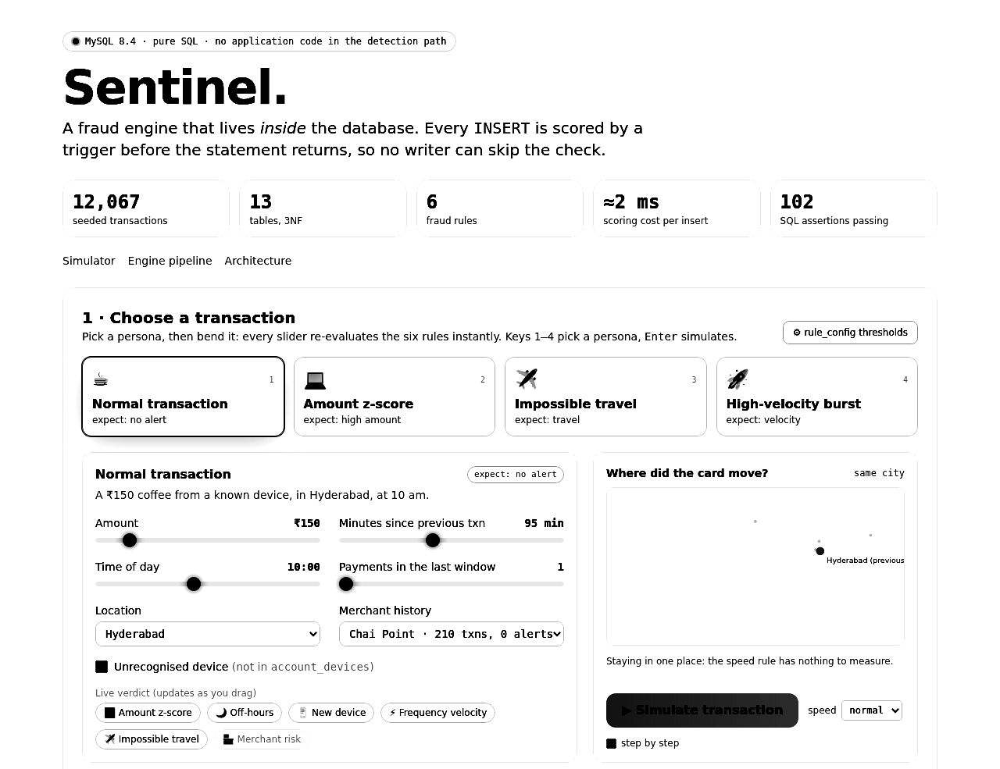

**Figure C.1 Landing view.**

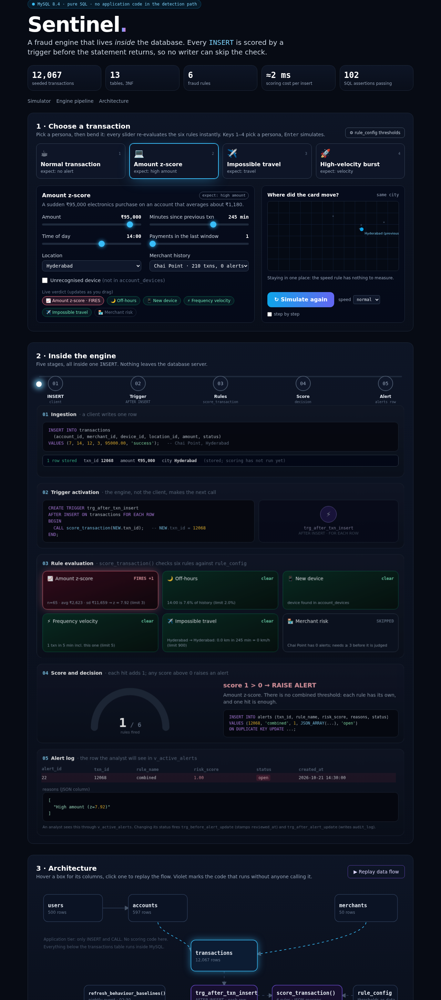

**Figure C.2 Pipeline for the amount z-score persona (an INR 95,000 purchase on an account averaging about INR 1,180).**

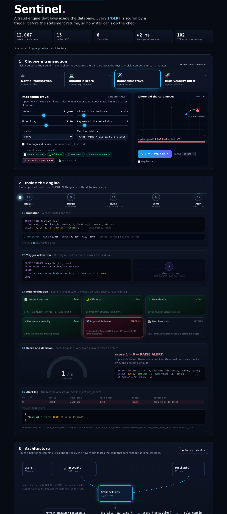

**Figure C.3 Pipeline for the impossible-travel persona (Hyderabad to Tokyo in 15 minutes).**

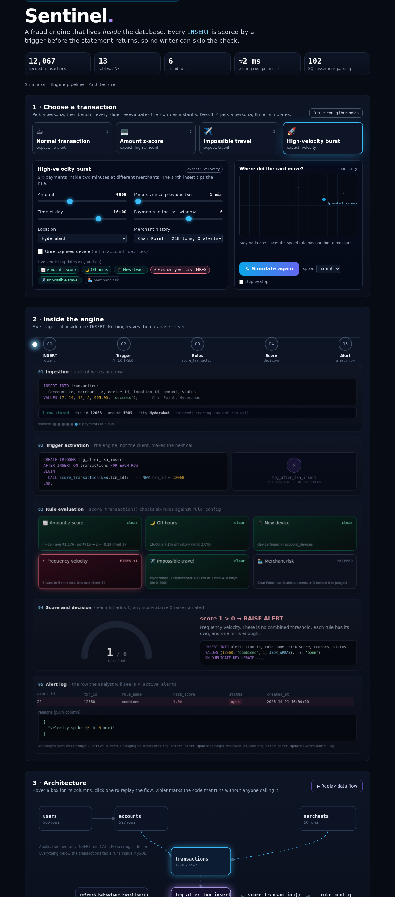

**Figure C.4 Pipeline for the high-velocity persona (a burst of payments inside the five-minute window).**
