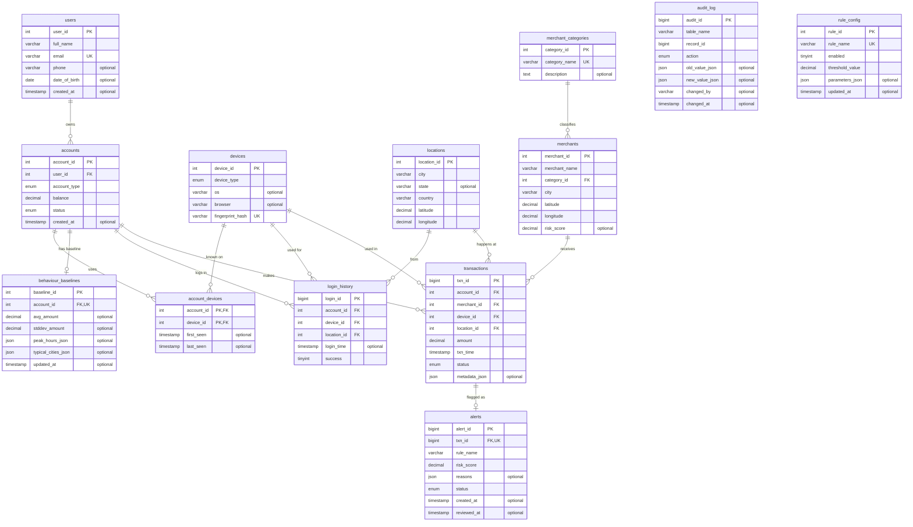

# ER diagram — Sentinel

> **Generated** by `scripts/gen_er_docs.py` from the real schema (`reference/schema_fingerprint_week10.txt`). Do not edit by hand;
> change the schema, rebuild, run `scripts/compare_to_reference.sh --update`, then `python3 scripts/gen_er_docs.py`.
> Reading the diagram: `||` exactly one, `o|` zero or one, `o{` zero or many. `PK` primary key, `FK` foreign key, `UK` unique key.
> In the lab you will *draw* this in the notation your faculty uses (rectangles, ellipses, diamonds - see `materials/src/NOTES/Key_features of ER.jpeg`
> in your DBMS study folder). This is the same content in a machine-drawn form. For the exam notation, translate it by hand.

## The 13 entities

| Table | Primary key | Columns | Foreign keys |
|---|---|---|---|
| `account_devices` | `account_id`, `device_id` | 4 | `account_id` → `accounts`, `device_id` → `devices` |
| `accounts` | `account_id` | 6 | `user_id` → `users` |
| `alerts` | `alert_id` | 8 | `txn_id` → `transactions` |
| `audit_log` | `audit_id` | 8 | — |
| `behaviour_baselines` | `baseline_id` | 7 | `account_id` → `accounts` |
| `devices` | `device_id` | 5 | — |
| `locations` | `location_id` | 6 | — |
| `login_history` | `login_id` | 6 | `account_id` → `accounts`, `device_id` → `devices`, `location_id` → `locations` |
| `merchant_categories` | `category_id` | 3 | — |
| `merchants` | `merchant_id` | 7 | `category_id` → `merchant_categories` |
| `rule_config` | `rule_id` | 6 | — |
| `transactions` | `txn_id` | 9 | `account_id` → `accounts`, `device_id` → `devices`, `location_id` → `locations`, `merchant_id` → `merchants` |
| `users` | `user_id` | 6 | — |

## Foreign keys and their delete rules

| Foreign key | Parent → child | ON DELETE |
|---|---|---|
| `fk_ad_account` | `accounts.account_id` ← `account_devices.account_id` | CASCADE |
| `fk_ad_device` | `devices.device_id` ← `account_devices.device_id` | CASCADE |
| `fk_accounts_user` | `users.user_id` ← `accounts.user_id` | CASCADE |
| `fk_alert_txn` | `transactions.txn_id` ← `alerts.txn_id` | CASCADE |
| `fk_bb_account` | `accounts.account_id` ← `behaviour_baselines.account_id` | CASCADE |
| `fk_lh_account` | `accounts.account_id` ← `login_history.account_id` | CASCADE |
| `fk_lh_device` | `devices.device_id` ← `login_history.device_id` | RESTRICT |
| `fk_lh_location` | `locations.location_id` ← `login_history.location_id` | RESTRICT |
| `fk_merchants_category` | `merchant_categories.category_id` ← `merchants.category_id` | RESTRICT |
| `fk_txn_account` | `accounts.account_id` ← `transactions.account_id` | CASCADE |
| `fk_txn_device` | `devices.device_id` ← `transactions.device_id` | RESTRICT |
| `fk_txn_location` | `locations.location_id` ← `transactions.location_id` | RESTRICT |
| `fk_txn_merchant` | `merchants.merchant_id` ← `transactions.merchant_id` | RESTRICT |

`CASCADE` = deleting the parent deletes the children. `RESTRICT` = the parent cannot be deleted while children exist.
How each rule turned into a table is explained in [`er-to-relational.md`](er-to-relational.md).
